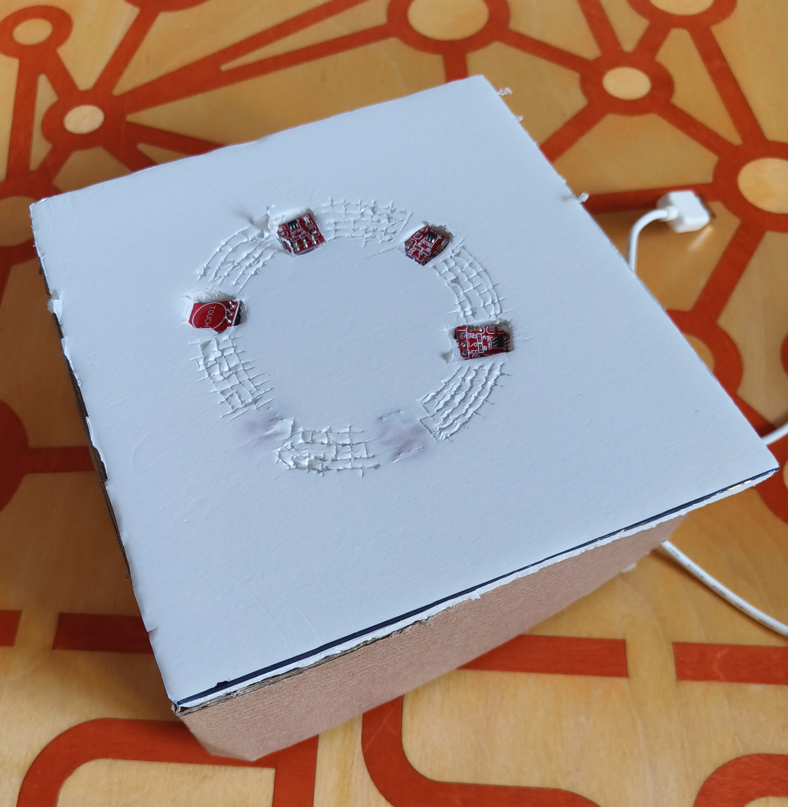
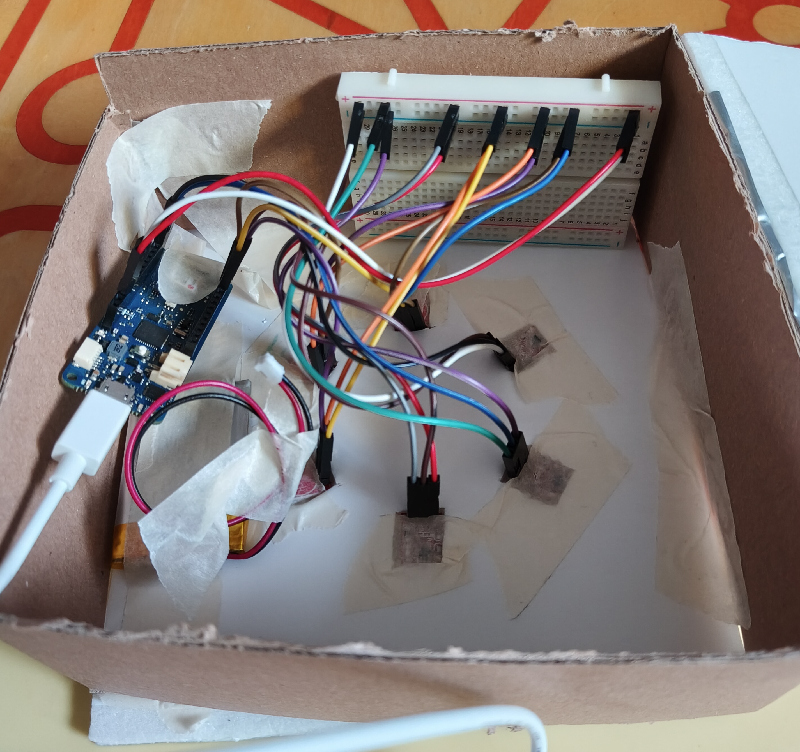
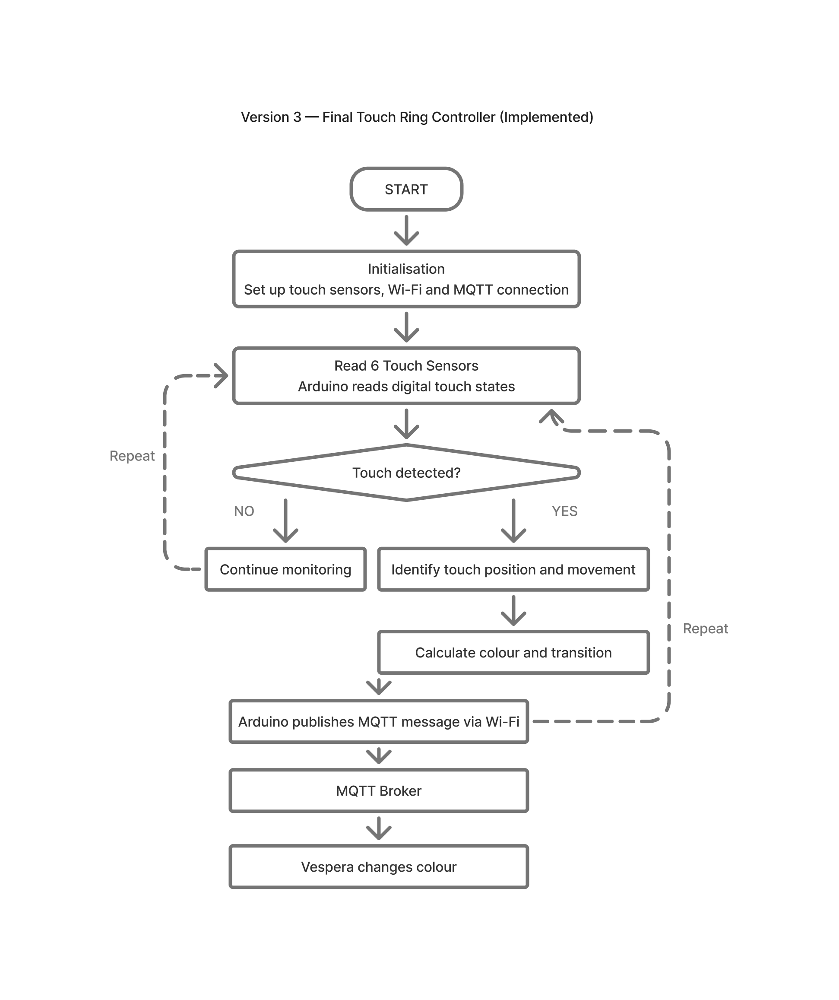

# Vespera — Touch Ring Lighting Controller

**CASA0014: Prototyping the Internet of Things**  
**MSc Connected Environments | University College London | 2026**

## 1. Project Overview

This project explores how a physical touch interface can create a more intuitive and engaging way to interact with a connected lighting installation.

Inspired by the tactile interaction of a DJ controller, I developed a circular interface using six HW-763 capacitive touch sensors. Users can change the colour of the Vespera lights by moving their finger around the ring.

An Arduino MKR WiFi 1010 processes the touch inputs and communicates with Vespera via Wi-Fi and MQTT. Software-based colour transitions help create a smoother visual response between the six discrete touch positions.

### Design Question

**How can six discrete touch sensors create a continuous-feeling, intuitive interaction with light?**

The project developed through sensor experimentation, hardware troubleshooting, interaction programming, colour refinement and informal user testing.

Feedback from three classmates revealed a usability challenge: users found it difficult to follow the touch ring while watching the lights. This led to a further physical iteration — a carved circular guide intended to help users navigate the interface through touch.

### Prototype at a Glance

| Component | Implementation |
|---|---|
| Microcontroller | Arduino MKR WiFi 1010 |
| Input | Six HW-763 capacitive touch sensors |
| Interaction | Circular finger movement and touch direction detection |
| Communication | Wi-Fi and MQTT |
| Output | Vespera lighting installation |
| Power | Battery-powered controller |
| Enclosure | Cardboard-based medium-fidelity prototype |
| Status | Functional prototype completed; further usability evaluation planned |

---

## 2. Prototype Demonstration

### Completed Physical Prototype

The final medium-fidelity prototype features six capacitive touch sensors arranged in a circular interface on a cardboard enclosure.

The controller is battery-powered and communicates wirelessly with the Vespera lighting installation.

**Completed Touch Interface**

The completed controller features six capacitive touch sensors arranged around a circular interface. A tactile guide was later carved into the surface following informal user testing.

**Internal Hardware Assembly**

The internal assembly includes the Arduino MKR WiFi 1010, touch sensor connections and battery power supply, housed within a cardboard enclosure.

### Video Demonstrations

Two demonstrations illustrate the interaction between the physical controller and the connected lighting system.

**Demo 1 — Touch Input and Web Visualisation**

[Watch the touch ring web demonstration](assets/demos/touch_ring_web_demo.mp4.mp4)

This video shows the touch controller being operated while the corresponding colour changes are displayed through the web interface.

**Demo 2 — Physical Vespera Lighting Response**

[Watch the physical Vespera demonstration](assets/demos/touch_ring_vespera_demo.mp4)

This video demonstrates how the touch controller affects the colours of the physical Vespera lighting installation.

Together, these demonstrations provide evidence of the implemented interaction, from physical touch input to the connected lighting response.
---

## 3. Interaction Design

### 3.1 Design Concept — A Touch-Based Colour Ring

Inspired by DJ controllers and circular colour selectors, I wanted to create a more playful and intuitive way to interact with light.

Instead of using six separate buttons to select fixed colours, I arranged six capacitive touch sensors around a circular interface.

The intention was to encourage users to slide their finger around the ring, creating the experience of continuously adjusting the light colour.

### 3.2 Touch Interaction

The controller uses six HW-763 capacitive touch sensors connected to an Arduino MKR WiFi 1010.

The interaction involves three main stages:

1. **Touch Detection:** Each sensor detects when a finger touches its sensing area.
2. **Movement Interpretation:** The Arduino processes changes in sensor activation to identify movement around the ring, including its direction.
3. **Lighting Response:** The processed input is transmitted via MQTT to control Vespera's colours.

Because the interface uses discrete sensors rather than a continuous touch surface, smooth colour transitions must be created through software.

### 3.3 Colour Transition Refinement

Initial testing showed that rapid movement between the six touch positions could produce visually abrupt colour changes.

I refined the colour transition logic to make the lighting response appear smoother.

I also experimented with different colour palettes. Very pale colours produced subtle transitions but made colour changes less noticeable. Further adjustments aimed to balance smoothness, colour clarity and visual appeal.

### 3.4 Physical Interaction and Tactile Guidance

Informal testing with three classmates revealed a limitation: users found it difficult to follow the touch ring while simultaneously watching the lights.

To address this, I carved a circular guide into the prototype's surface, providing a physical indication of the intended finger path.

For a more refined product, I would explore using contrasting surface textures, with a smoother circular track and a slightly higher-friction surrounding surface.

The carved guide has been implemented, but its effectiveness has not yet been evaluated through further user testing.
---

## 4. System Architecture

### 4.1 System Overview

The Vespera controller is an Arduino-based Internet of Things (IoT) system that translates physical touch interactions into wireless lighting commands.

The system consists of four main stages:

1. **Sensing:** Six HW-763 capacitive touch sensors detect finger contact at different positions around the circular interface.
2. **Processing:** The Arduino MKR WiFi 1010 reads the sensor outputs and processes touch sequences to determine movement around the ring.
3. **Communication:** The Arduino connects to Wi-Fi and publishes lighting control messages through an MQTT broker.
4. **Actuation:** The Vespera lighting installation responds to the received commands by changing its colours.

### 4.2 Data Flow

**Finger movement → Capacitive touch sensors → Arduino MKR WiFi 1010 → Wi-Fi → MQTT Broker → Vespera lighting installation**

The sensors provide discrete digital inputs. The Arduino interprets these inputs and applies colour control logic, including smoother transitions between colours.

MQTT provides the communication mechanism between the physical controller and the connected lighting installation.

A separate web-based demonstration was also used to observe the colour response during development.

### 4.3 Power Supply

The completed physical controller uses a battery power supply, allowing it to operate without a continuous USB connection to a laptop.

This makes the controller more portable and allows the interaction interface to be positioned independently of the computer.

### 4.4 System Diagram

The following flowchart illustrates the main control logic of the completed Vespera touch ring prototype.

The Arduino continuously monitors six capacitive touch sensors. When touch input is detected, the controller interprets the touch position and movement, calculates the colour response and publishes a command over Wi-Fi to the MQTT broker.

The Vespera installation receives the corresponding message and changes colour.

The dashed arrows represent the repeated monitoring cycle. This diagram is a simplified representation of the control logic rather than a line-by-line description of the Arduino program.

Earlier interaction concepts and alternative approaches are documented in the [Concept Sketches](assets/sketches/README.md).
