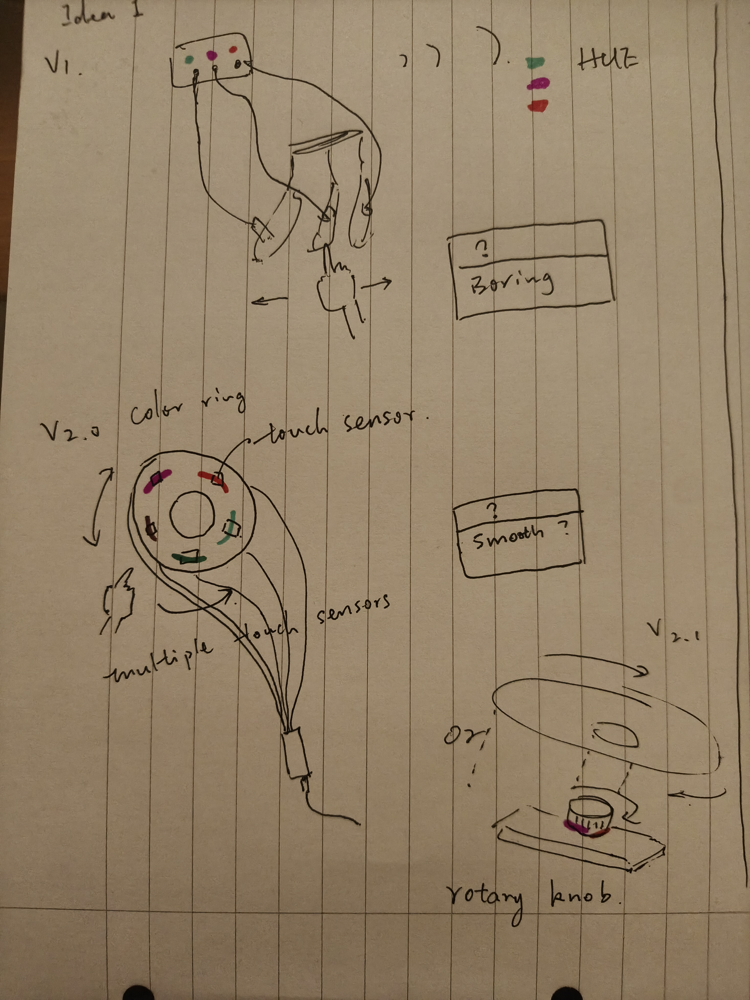
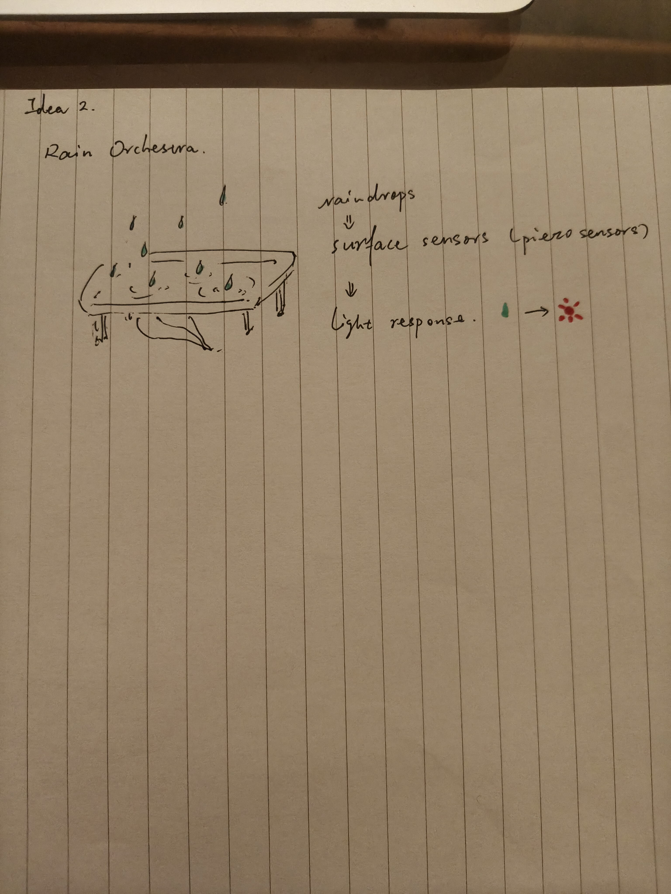

# Vespera — Concept Sketches

This folder documents the early design exploration and interaction concepts for my CASA0014 Vespera controller.

The sketches represent ideas under consideration rather than completed implementations.

## Idea 1 — Touch-Based Light Controller

### Version 1 — Touch Interaction

The initial idea explored using multiple touch-sensitive points (plants or fruit) to control different light colours.

### Version 2 — Circular Colour Control

I explored arranging capacitive touch sensors around a circular interface, allowing users to change the light colour by moving their finger around the ring.

**Design challenge:** Can discrete touch sensors create a sufficiently smooth colour transition?

### Version 2.1 — Rotary Alternative

An alternative design uses a rotary knob to change the light colour.

This may provide more continuous control, but it changes the physical interaction from sliding a finger to rotating a component.

**Open question:** Which interface would offer a more intuitive and engaging experience?

**Status:** Concept exploration. Touch sensing has been tested separately, but these interfaces have not yet been implemented.

---

## Idea 2 — Rain Orchestra

Rain Orchestra explores the possibility of using falling raindrops as a natural input for controlling light.

The concept investigates whether sensors, potentially piezoelectric sensors, could detect raindrop impacts and translate them into changes in light colour or behaviour.

**Questions to explore:**
- Can individual raindrop impacts be detected reliably?
- How could rainfall intensity or frequency influence the light?
- What technical challenges might arise when using water near electronic components?

**Status:** Initial concept — not yet tested.

---

## Next Steps

- Test the feasibility of the proposed interactions.
- Compare sensor capabilities and limitations.
- Refine the selected concept based on experimental observations.
- Develop a physical prototype using available lab materials.
